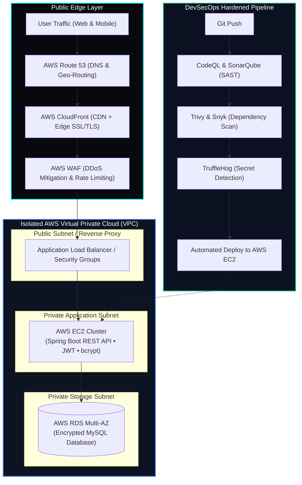

<div align="center">

<!-- Header Dynamic Neon Cyber Banner -->


<!-- Dynamic Animated Typing SVG -->
<a href="https://stharsan.onrender.com/">
  
</a>

<!-- Live Cyber Badges Row -->
<p align="center">
  
  
  
  
</p>

<!-- Social & Verified Hub Badges -->
<p align="center">
  <a href="https://stharsan.onrender.com/"></a>
  <a href="https://www.linkedin.com/in/tharsan1305"></a>
  <a href="https://drive.google.com/file/d/1Nz2AmiWbBcT22ZLd_xpf_NlX_mpFQoLw/view?usp=sharing"></a>
  <a href="https://tryhackme.com/p/stharsan13052007"></a>
  <a href="https://www.credly.com/users/tharsan1305"></a>
  <a href="https://builder.aws.com/community/@tharsan"></a>
  <a href="https://medium.com/@stharsan.cs"></a>
  <a href="https://leetcode.com/u/stharsan13"></a>
</p>

</div>

---

### 🖥️ `[root@tharsan-soc ~]# cat profile.json`

```json
{
  "engineer": "THARSAN S",
  "status": "Pre-Final Year B.E. Computer Science & Engineering (Cybersecurity)",
  "institution": "J.J. College of Engineering & Technology (Anna University)",
  "academic_standing": "8.3 / 10 CGPA",
  "specialization": ["AI Security", "Cloud Security (AWS)", "DevSecOps", "Full-Stack Software"],
  "core_project": "PragatiX (Live Production Platform on Web, Play Store & App Store)",
  "ambassadorships": ["Microsoft Future Student Ambassador", "FUEL Member Ambassador @ Palo Alto Networks"],
  "target_roles": ["AI Security Engineer", "Cloud Security Engineer", "DevSecOps Engineer", "AppSec Engineer"]
}
```

I am a cybersecurity engineering student and software developer building secure, scalable cloud applications. I lead frontend UI/UX and application security for **PragatiX**, a campus platform launched September 7, 2026 on Web, Google Play Store, and iOS App Store. My engineering work covers **AWS cloud infrastructure, Spring Boot microservices, React web portals, automated DevSecOps CI/CD, and AI security guardrails**.

---

### 🏆 Key Milestones & Metrics

| Metric | Verification & Standing | Production Impact |
| :--- | :--- | :--- |
| 🎓 **Academic Standing** | **8.3 / 10 CGPA** | B.E. CSE (Cybersecurity Specialization) |
| 🚀 **Production Platforms** | **PragatiX & Client Solutions** | Live on Web, Google Play & Apple App Store |
| 👥 **Platform Reach** | **100+ Active Users** | Production 3-tier resilient architectures |
| 🥇 **Cybersecurity Honors** | **1st Prize (₹10,000)** | District Cybersecurity Poster Competition |
| 🥈 **Hackathon Winner** | **2nd Place (₹7,000)** | JJCET Annual Technical Hackathon |
| 🛡️ **TryHackMe Standing** | **Top 25% Globally** | 19 Rooms Completed • 3 Pathway Badges |

---

### ☁️ Production Cloud Security Architecture (PragatiX Platform)



---

### 🔥 Featured Production Platforms & Projects

<table>
  <tr>
    <td width="50%" valign="top">
      <h3 align="center">📱 PragatiX: Production Campus Platform</h3>
      <p align="center">
        <a href="https://pragatix.in"></a>
        <a href="https://play.google.com/store/apps/details?id=jjcet.PragatiX"></a>
        <a href="https://apps.apple.com/us/app/pragatix/id6814354285"></a>
      </p>
      <ul>
        <li><b>Stack:</b> Spring Boot REST API, MySQL RDS, React.js Web Portal, Flutter Mobile App.</li>
        <li><b>Cloud Defense:</b> Deployed on AWS (EC2, RDS, CloudFront, Route 53). Built JWT-based RBAC, bcrypt password hashing, and dependency vulnerability scanning in GitHub Actions CI/CD.</li>
        <li><b>Status:</b> Live campus production serving students, faculty, and administrative tiers.</li>
      </ul>
    </td>
    <td width="50%" valign="top">
      <h3 align="center">🤖 AI-Powered API Pentesting Agent</h3>
      <p align="center">
        <a href="https://github.com/tharsan1305"></a>
        
      </p>
      <ul>
        <li><b>Features:</b> Ingests OpenAPI/Swagger specs and Postman collections; automatically scans endpoints for BOLA/IDOR, broken authentication, JWT tampering, and injection vectors.</li>
        <li><b>AI Triage:</b> Uses OpenAI API to generate contextual code patches, vulnerability ratings, and executive risk summaries.</li>
      </ul>
    </td>
  </tr>
  <tr>
    <td width="50%" valign="top">
      <h3 align="center">🛡️ SENTINEL.AI — Phishing & URL Threat Analyzer</h3>
      <p align="center">
        <a href="https://phishing-email-detection-model-psi.vercel.app/"></a>
        <a href="https://github.com/tharsan1305"></a>
      </p>
      <ul>
        <li><b>Tech:</b> Python, Flask, TF-IDF Vectorization, Multinomial Naive Bayes.</li>
        <li><b>Capabilities:</b> Real-time email body scanning, malicious lexical URL heuristics, email sandbox simulator, and risk-breakdown diagnostics.</li>
      </ul>
    </td>
    <td width="50%" valign="top">
      <h3 align="center">🔍 Network Vulnerability Scanner</h3>
      <p align="center">
        <a href="https://vulnerability-scanner-eight-delta.vercel.app/"></a>
        <a href="https://github.com/tharsan1305/Vulnerability-Scanner"></a>
      </p>
      <ul>
        <li><b>Tech:</b> Python, Flask, Socket Programming, Nmap engine, SQLite.</li>
        <li><b>Capabilities:</b> Real-time TCP port reconnaissance, service banner grabbing, vulnerability signature classification, and downloadable audit reports.</li>
      </ul>
    </td>
  </tr>
  <tr>
    <td width="50%" valign="top">
      <h3 align="center">🗺️ Cybersecurity Roadmap 2026</h3>
      <p align="center">
        <a href="https://github.com/tharsan1305/CyberSecurity-Roadmap-2026"></a>
      </p>
      <ul>
        <li>A day-by-day learning roadmap covering networking, Linux, Cloud, DevSecOps, Pentesting, SOC, DFIR, and AI Security.</li>
      </ul>
    </td>
    <td width="50%" valign="top">
      <h3 align="center">🚀 SIH-2026 Toolkit & Guide</h3>
      <p align="center">
        <a href="https://github.com/tharsan1305/SIH-2026"></a>
      </p>
      <ul>
        <li>Comprehensive Smart India Hackathon kit: domain guides (AI/ML, Cyber, Cloud), PPT templates, and evaluation frameworks.</li>
      </ul>
    </td>
  </tr>
</table>

---

### 🛠️ Technical Skill Matrix

<div align="center">

#### 💻 Programming & Scripting
<a href="#">
  
</a>

#### 🤖 AI, LLMs & Machine Learning
<a href="#">
  
</a>
<p><i>RAG Architecture • MongoDB Vector Search • Claude API • OpenAI API • Prompt Engineering • LLM Security Guardrails</i></p>

#### ⚙️ Frameworks & Backends
<a href="#">
  
</a>

#### ☁️ Cloud, DevOps & DevSecOps
<a href="#">
  
</a>
<p><i>AWS (EC2, RDS, CloudFront, Route 53, S3, Security Hub) • Railway • CI/CD Pipelines • Container Security</i></p>

#### 🗄️ Databases & Storage
<a href="#">
  
</a>

#### 🛡️ Cybersecurity & Pentesting Tools
<a href="#">
  
</a>
<p><i>OWASP Top 10 • OWASP API Security • Burp Suite • Nmap • Metasploit • OWASP ZAP • OSINT • Threat Intel • JWT / bcrypt</i></p>

</div>

---

### 🏆 Verified Certifications & Credentials

- 🎖️ **Google Cloud:** Machine Learning Operations (MLOps) for Generative AI — [Verify Profile](https://www.skills.google/public_profiles/4f892d54-bf92-4b00-909f-184b24b497c0)
- 🛡️ **OPSWAT Academy:** Cybersecurity Fundamentals Associate (OCFA) — [Credential d8tvCZZvcg](https://learn.opswatacademy.com/certificate/d8tvCZZvcg)
- 🛡️ **ISC2:** Certified in Cybersecurity (CC) Candidate — [Verify Badge](https://www.credly.com/badges/3c8c1446-a14e-41ab-aea5-d899194d9afa/public_url)
- 🌐 **Cisco:** Introduction to Modern AI — [Verify Badge](https://www.credly.com/badges/11f830d7-01d9-4762-aca3-91299fab2568/public_url)
- 🍃 **MongoDB:** Securing MongoDB Self-Managed Networking & Building RAG Apps — [Credly](https://www.credly.com/users/tharsan1305)
- 🛡️ **Hackviser:** Certified Cybersecurity Foundations (CORE) — [Verify HV-CORE-MO1IKK9E](https://hackviser.com/verify?id=HV-CORE-MO1IKK9E)
- 🎭 **The SecOps Group:** Certified Social Engineering Defense Practitioner (CSEDP) — `ID: 11623889`
- 🧠 **Anthropic:** Claude Code API Development
- 🔍 **ArcX:** Cyber Threat Intelligence Analyst
- 🏢 **Industry Job Simulations:** Deloitte Cyber • Mastercard Cyber Simulation • Datacom Cloud Ops • Tata Cybersecurity Analyst

---

### ✍️ Published Articles & Insights

- ☁️ [Why Companies Choose AWS: Connect a Frontend, Backend and Security the Easy Way](https://builder.aws.com/content/3KZw5soZusIH7X5wmDVQe6ASZtf/why-companies-choose-aws-connect-a-frontend-backend-and-security-the-easy-way) — *AWS Builder Center*
- ⚡ [Why Amazon EC2 Is the Heart of AWS: A Real-World Example with an Online Shop](https://builder.aws.com/content/3KRTk2TITjBS0uxfSz39GOYoIcp/why-amazon-ec2-is-the-heart-of-aws-a-real-world-example-with-an-online-shop) — *AWS Builder Center*
- 🔐 [Zero Trust Security: Why "Verify Identity" Isn't Enough Anymore (And What's Next for AI Agents)](https://medium.com/@stharsan.cs) — *Medium*
- 💼 [Why Most Cybersecurity Students Never Get Hired](https://linkedin.com/in/tharsan1305) — *LinkedIn*

---

### 📈 GitHub Statistics & Activity

<div align="center">

<p align="center">
  
  
</p>

<p align="center">
  
</p>

<p align="center">
  
</p>

<p align="center">
  
</p>

</div>

---

### 🌐 Secure Communication & Profiles

<div align="center">

| Platform | Handle / Link | Direct Action |
| :--- | :--- | :--- |
| 🌍 **Portfolio** | `stharsan.onrender.com` | [Visit Website](https://stharsan.onrender.com/) |
| 💼 **LinkedIn** | `/in/tharsan1305` | [Connect](https://www.linkedin.com/in/tharsan1305) |
| 📧 **Email** | `stharsan13052007@gmail.com` | [Send Message](mailto:stharsan13052007@gmail.com) |
| 🛡️ **TryHackMe** | `@stharsan13052007` (Top 25%) | [View Profile](https://tryhackme.com/p/stharsan13052007) |
| 📜 **Credly** | `tharsan1305` | [Verify Badges](https://www.credly.com/users/tharsan1305) |
| 🚀 **NexoraCrew** | `nexoracrew.com` | [Explore Platform](https://nexoracrew.com/) |
| 📱 **PragatiX** | `pragatix.in` | [Open Production App](https://pragatix.in) |
| 📄 **Resume** | Direct Google Drive Access | [Download Resume](https://drive.google.com/file/d/1Nz2AmiWbBcT22ZLd_xpf_NlX_mpFQoLw/view?usp=sharing) |
| 💻 **LeetCode** | `@stharsan13` | [View Solutions](https://leetcode.com/u/stharsan13) |
| 📝 **Medium** | `@stharsan.cs` | [Read Publications](https://medium.com/@stharsan.cs) |
| 🪪 **Google Skills** | Cloud & GenAI Badges | [Public Transcript](https://www.skills.google/public_profiles/4f892d54-bf92-4b00-909f-184b24b497c0) |
| 🎓 **Microsoft Learn** | Learning Profile | [Transcript](https://learn.microsoft.com/en-gb/users/tharsan13/) |
| 🐦 **X (Twitter)** | `@THARSANat6` | [Follow](https://x.com/THARSANat6) |
| 💬 **Discord** | Community Hub | [Join Server](https://discord.gg/ZVBDVU65) |

</div>

<br/>

<div align="center">
  <h3>⚡ Building Secure Systems • Learning Continuously • Creating Impact</h3>
  <p><b>AI Software Engineer</b> • <b>AI Security & DevSecOps Researcher</b></p>
</div>


